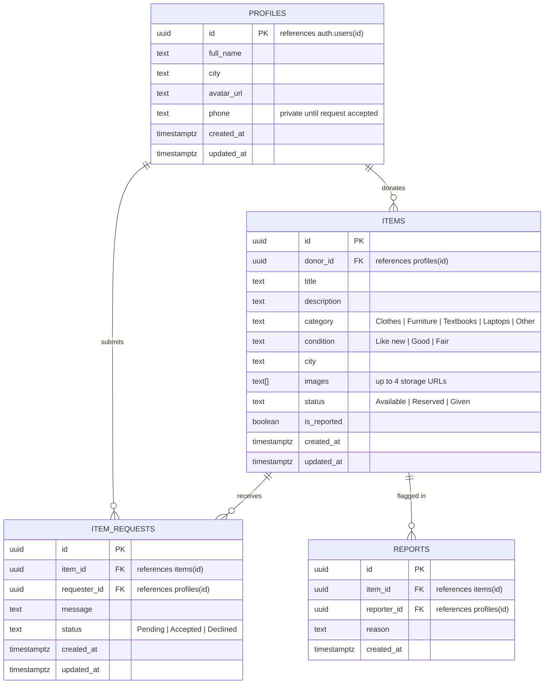

# GiveLoop 🔄

> A community-driven free giveaway and donation platform built for students and communities to give old clothes, study furniture, used textbooks, and laptops a second life.

[](https://nextjs.org/)
[](https://www.typescriptlang.org/)
[](https://tailwindcss.com/)
[](https://supabase.com/)

---

## 📌 Project Overview
Many households and graduating students possess functional items (textbooks, laptops, jackets, study desks) they no longer need, while incoming and under-resourced students struggle to afford them. **GiveLoop** eliminates financial barriers by connecting donors directly with recipients in a safe, moderated environment.

---

## 📸 Screenshots
*(Screenshots will be captured and added here upon UI deployment)*
- **Browse Page & Multi-Filter Grid**: `[Screenshot Placeholder: /public/screenshots/browse.png]`
- **Item Detail & Donor View**: `[Screenshot Placeholder: /public/screenshots/detail.png]`
- **Donate Form with Image Upload & Compression**: `[Screenshot Placeholder: /public/screenshots/donate.png]`
- **Donor & Requester Dashboard**: `[Screenshot Placeholder: /public/screenshots/dashboard.png]`

---

## 🛠 Tech Stack

| Layer | Technology | Rationale |
| :--- | :--- | :--- |
| **Framework** | Next.js 16 (App Router) | Server components, streaming, fast page loads, SEO metadata |
| **Language** | TypeScript | Compile-time safety and type contract enforcement |
| **Styling** | Tailwind CSS v4 | Utility-first styling, zero-runtime overhead, built-in dark mode |
| **Backend & DB** | Supabase (PostgreSQL) | Managed relational DB, JWT Auth, Row Level Security, Storage |
| **Validation** | Zod 4 + React Hook Form | Dual-layer schema validation on client and server |
| **Icons** | Lucide React | Lightweight, accessible SVG icon library |
| **Testing** | Vitest & Playwright | Fast unit tests + browser-level e2e test flows |

---

## 🗄 Database Schema & Relationships



---

## 🛡 Security Architecture & Decisions

1. **Row Level Security (RLS)**:
   - RLS is explicitly enabled on all tables (`profiles`, `items`, `item_requests`, `reports`).
   - Anyone can read active listings.
   - Only the item donor can edit, delete, or mark an item as `Given`.
   - Item requests are visible **only** to the requester and the item's donor.
2. **Contact Privacy**:
   - Phone numbers and direct contact details are never exposed on public item cards.
   - Contact details are only unlocked when the donor formally accepts a user's request.
3. **Anti-Spam Controls**:
   - Unique constraints prevent duplicate requests for the same item (`UNIQUE(item_id, requester_id)`).
   - Donors are prevented from requesting or reporting their own items.
   - File uploads are restricted to authenticated users, capped at 5MB, and limited to image MIME types (`image/jpeg`, `image/png`, `image/webp`).
4. **Environment Isolation**:
   - Only `NEXT_PUBLIC_SUPABASE_URL` and `NEXT_PUBLIC_SUPABASE_ANON_KEY` are exposed to the client.
   - Service role keys are never included or bundled in frontend client code.

---

## ⚙️ Setup & Local Development

### 1. Clone & Install Dependencies
```bash
git clone https://github.com/your-username/giveloop.git
cd giveloop
npm install
```

### 2. Configure Supabase
1. Create a free project at [supabase.com](https://supabase.com).
2. Go to **SQL Editor** in your Supabase Dashboard.
3. Paste and run [`supabase/schema.sql`](file:///Users/ssujit/giveloop/supabase/schema.sql).
4. Paste and run [`supabase/seed.sql`](file:///Users/ssujit/giveloop/supabase/seed.sql) to populate 25 realistic sample items across Bangalore, Mumbai, and Delhi.

### 3. Set Up Environment Variables
Create a `.env.local` file by copying the example:
```bash
cp .env.example .env.local
```
Fill in your Supabase credentials:
```env
NEXT_PUBLIC_SUPABASE_URL=https://your-project.supabase.co
NEXT_PUBLIC_SUPABASE_ANON_KEY=your-supabase-anon-key
NEXT_PUBLIC_SITE_URL=http://localhost:3000
```

### 4. Run Development Server
```bash
npm run dev
```
Open [http://localhost:3000](http://localhost:3000) in your browser.

---

## 💡 What I Learned & Future Improvements

### Key Engineering Takeaways:
- **Defense-in-depth with RLS**: Client-side authentication checks can be manipulated in the browser; true access control must live in Postgres via RLS policies.
- **Client-Side Image Optimization**: Compressing images to WebP via HTML5 Canvas prior to upload dramatically reduces storage costs and upload latency.
- **SSR & Next.js Cookies**: Managing Supabase sessions in Server Components requires synchronized cookie exchange across middleware, server components, and browser clients.

### Roadmap & Future Features:
- 💬 **In-App Realtime Chat**: Direct messaging between donor and recipient via Supabase Realtime channels.
- 🔔 **Push & Email Notifications**: Notify users instantly when their request is accepted or a new matching item is listed in their city.
- 🗺️ **Interactive Map View**: Leaflet / Mapbox integration to visualize nearby pickup locations by radius.
- 🛡️ **Admin Dashboard**: Dedicated administrative panel to review flagged listings and moderate user conduct.
